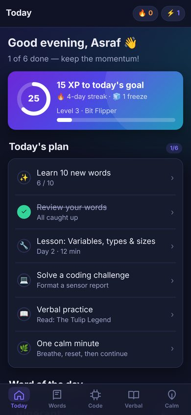
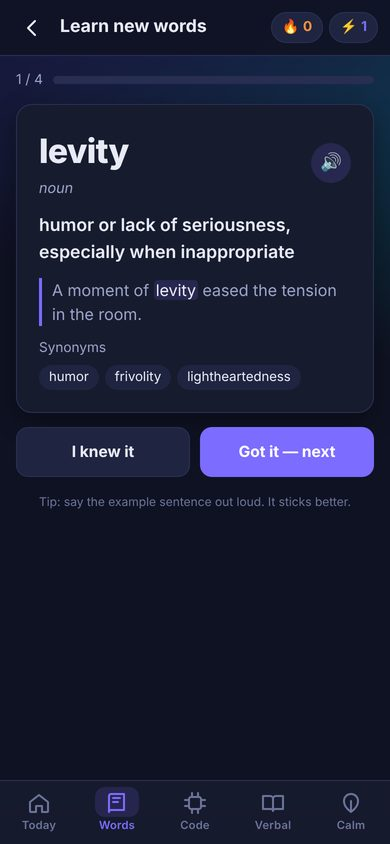
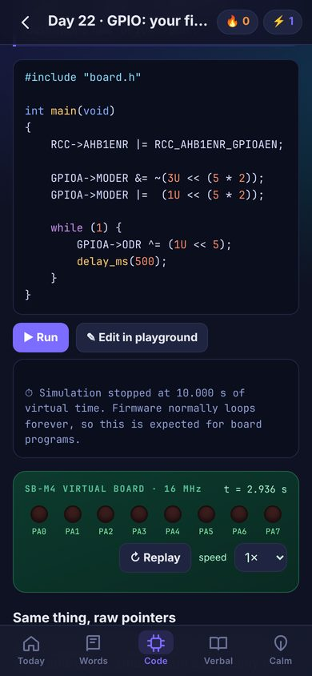
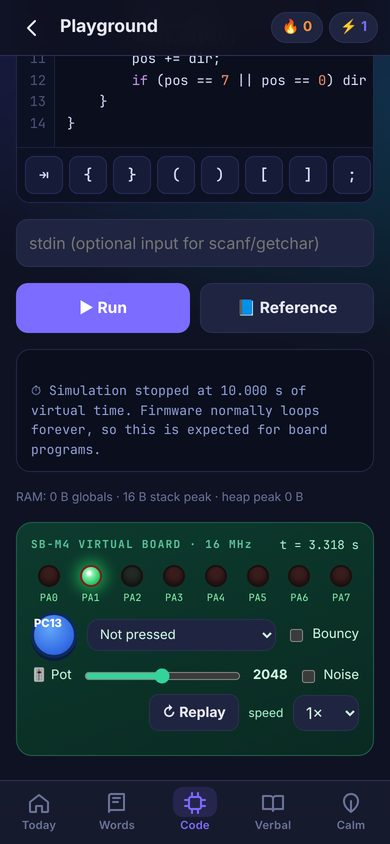
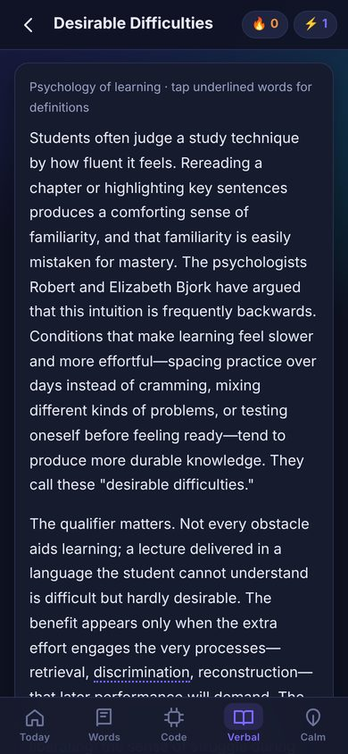
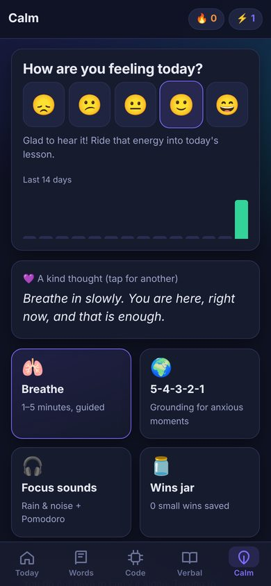

# SkillBoost ⚡

A daily study companion for Android that works fully offline. It covers:

- **GRE & IELTS vocabulary**: 570+ words with spaced repetition, quizzes and games
- **GRE Verbal**: reading passages, text completion and sentence equivalence
- **IELTS**: a speaking timer with cue cards, Writing Task 2 practice, and useful language
- **Embedded systems**: a 30-day course with lessons on C, pointers, bits, microcontrollers, interrupts, timers, UART, ADC and CPU architecture, plus **60 auto-graded coding challenges**. Your code runs on a simulated ARM Cortex-M board, right on your phone.
- **A calm corner**: mood check-ins, guided breathing, grounding, focus sounds and a "wins jar"

Streaks (with streak freezes for tough days), XP, levels, badges and a daily reminder keep it going.

| Today | Words | Lesson + board | Playground | Reading | Calm |
|---|---|---|---|---|---|
|  |  |  |  |  |  |

## Install on your phone

1. On your Android phone (Android 7.0 or newer), open this repository on GitHub and go to **`dist/SkillBoost.apk`**. Tap **Download** (the "View raw" link).
2. Open the downloaded file. If Android asks, allow your browser or file manager to **install unknown apps**.
3. Tap **Install** and open **SkillBoost**.

Your progress stays on your phone and nothing is uploaded. Use **Profile → Backup → Export** now and then, so you can restore your progress after reinstalling.

## A day with SkillBoost

The **Today** tab builds a plan each day:

1. ✨ Learn 10 new words, then take a quick check quiz.
2. 🔁 Review the words that are due. The spaced repetition scheduler (SM-2) brings each word back just before you would forget it.
3. 🔧 Read today's embedded lesson and take its quiz.
4. 💻 Solve a coding challenge.
5. 📖 Do some verbal practice: one reading passage or a text-completion set.
6. 🌿 Take one calm minute.

Reaching your daily XP goal keeps the streak alive. You earn a streak freeze every 7 days, and it protects the streak if you miss a day.

## The C simulator

The Code tab compiles and runs real C. Everything is written in JavaScript (`web/js/minic/`), so it works offline and needs nothing installed:

- A C preprocessor, a parser with typed checks, and GCC-style errors and warnings. It catches things like `if (x = 5)`, `uint8_t v = 300`, `printf` format mismatches, unused variables, and "did you mean…?" spelling suggestions.
- A 32-bit ARM memory model: Flash at `0x08000000`, SRAM at `0x20000000`, and real pointer arithmetic, structs, unions, bit-fields, padding and endianness. Uninitialized memory contains garbage, just like real hardware.
- Faults are explained in plain words: NULL dereference, writing to a string literal in Flash, double `free`, stack overflow, and interrupt storms.
- A virtual **STM32F4-style board** (`#include "board.h"`):
  - 8 LEDs on PA0–PA7
  - a user button on PC13, with optional contact bounce
  - a potentiometer on ADC1, with optional noise
  - a UART terminal on USART2
  - TIM2, SysTick, EXTI and NVIC interrupts

  It enforces clock gating (`RCC->AHB1ENR`) and pin modes (`MODER`), the way real silicon does.

## Building

```bash
# Ubuntu / Debian
sudo apt-get install aapt apksigner zipalign dalvik-exchange zip default-jdk
sudo mkdir -p /opt/android-platform
sudo curl -o /opt/android-platform/android-34.jar \
  https://raw.githubusercontent.com/Sable/android-platforms/master/android-34/android.jar
export KEYSTORE_PASS='choose-a-password'   # the first build creates android/skillboost.keystore
./scripts/build-apk.sh                      # -> dist/SkillBoost.apk
```

The build doesn't need Gradle or the full Android SDK. The native part is a small WebView shell in `android/` with text-to-speech, reminders, sharing, haptics and a backup copy of your progress. The app itself is plain HTML, CSS and JS in `web/`, so you can also open `web/index.html` in a desktop browser while developing.

The signing key (`android/skillboost.keystore`) is private, so it is git-ignored. Back it up: Android only installs an update over an existing app if both builds are signed with the same key. If the key changes, uninstall the old app first, and use **Export** and **Import** to keep your progress.

To release an update, raise the `version` and `code` numbers in `web/version.json`, then rebuild.

## Tests

```bash
npm test            # C compiler/VM tests + validates all 30 lessons (every solution passes, every starter fails)
npm run test:e2e    # clicks through every screen in Chromium at phone size (needs Playwright)
```

## Project layout

```
android/            WebView shell (Java), manifest, icons
web/                the app
  js/minic/         C preprocessor, parser, VM, virtual board, grader
  js/data/          vocabulary, lessons, verbal passages, IELTS, calm content
  js/views/         Today, Words, Code, Verbal, Calm, Profile screens
scripts/            APK build + icon generation
tests/              unit, lesson-validation and end-to-end tests
dist/SkillBoost.apk ready-to-install build
```
